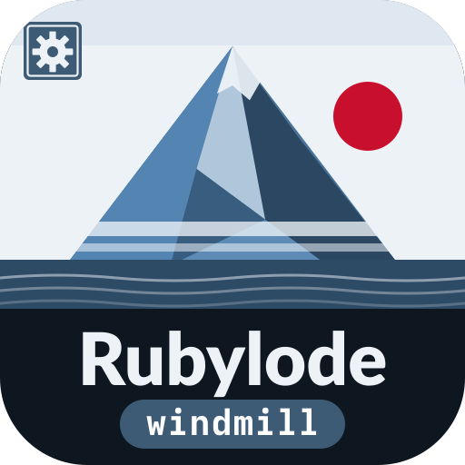
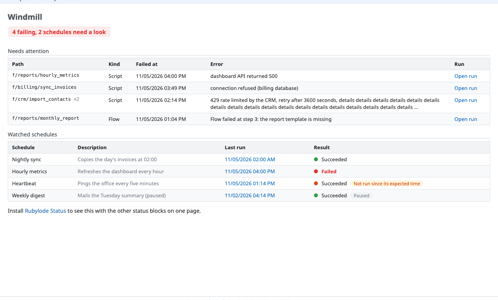
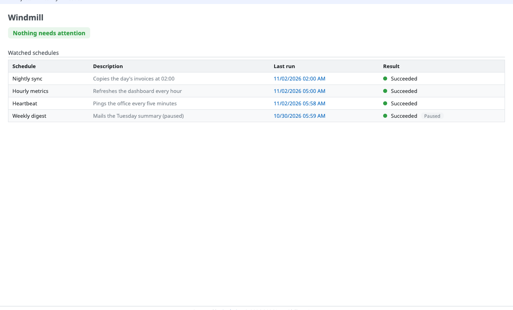
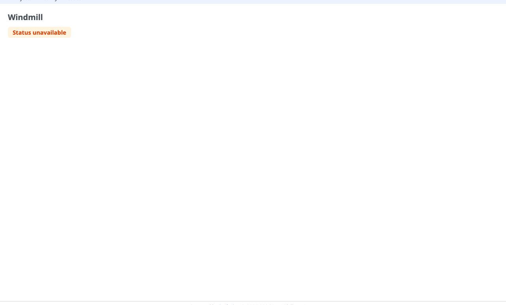
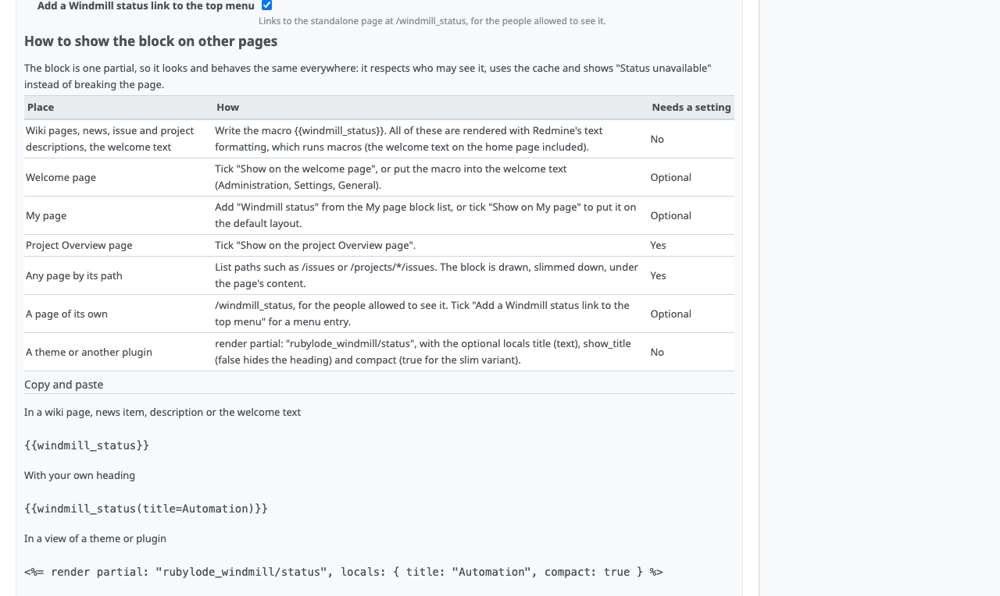

# Rubylode Windmill

<p></p>

[](https://github.com/rubylode/redmine-rubylode-windmill/actions/workflows/tests.yml)
[](https://github.com/rubylode/redmine-rubylode-windmill/actions/workflows/security.yml)
[](https://github.com/rubylode/redmine-rubylode-windmill/tags)
[](https://github.com/rubylode/redmine-rubylode-windmill/blob/main/LICENSE)


Rubylode Windmill is a plugin for Redmine 5.1 or newer that shows the state of a [Windmill](https://www.windmill.dev) workspace: the recent failed runs of scripts and flows that may need attention, and the latest run of the schedules you choose to watch.

The block goes on a wiki page, a page of its own, My page, the welcome page, a project's Overview, the bottom of chosen pages, or another plugin's view. A summary line says "Nothing needs attention" or "3 failing". Windmill is asked once per cache window, not once per page view. When it cannot be reached the block says "Status unavailable" and the rest of the page renders as usual.

Version 2.0.0 needs Redmine 5.1 or newer. CI runs the test suite on Redmine 7.0, 6.1, 6.0 and 5.1. `docs/roadmap/ROADMAP.md` lists what is decided and what is still open. Upgrading from 1.x: see the 2.0.0 entry in `CHANGELOG.md`.







## Install

1. Put the plugin folder in Redmine's `plugins/` directory, named `redmine_rubylode_windmill`. For example: `git clone https://github.com/rubylode/redmine-rubylode-windmill.git redmine_rubylode_windmill`.
2. Run `bundle exec rake redmine:plugins:migrate RAILS_ENV=production`.
3. Create a Windmill API token (Account settings, Tokens) for a user who can read the workspace's runs and schedules. Put it in the environment of the Redmine process, for example as `WINDMILL_API_TOKEN` (see Security), then restart Redmine.
4. In Administration, Plugins, open Rubylode Windmill and choose Configure. Fill in the Windmill address and the workspace id.

The migration renames the saved `windmill_url` setting to `base_url`. It writes nothing on a fresh install.

## Settings

Everything except the token is a plugin setting.

| Setting | Default | Meaning |
|---|---|---|
| Windmill address (`base_url`) | empty | For example `https://windmill.example.com`. While empty, administrators see a hint and everyone else sees nothing. |
| Workspace id | empty | The workspace to watch, the name after `workspace=` in Windmill's run links. |
| Token variable | `WINDMILL_API_TOKEN` | The name of the environment variable that holds the API token. It must start with `WINDMILL_`. See Security. |
| Allowed hosts | empty | Hosts that may receive the token besides the Windmill address, separated by spaces or commas. Redirects to other hosts are never followed. |
| Allow plain http | off | Needed for `http://` to anything but this machine. See Security. |
| Look-back hours | 24 | Failed runs that started within this many hours are considered. |
| Maximum rows | 10 | At most this many rows are listed. Failing paths beyond this are counted, not listed. |
| Path prefix filter | empty | Only scripts and flows whose path starts with this are listed, for example `f/billing/`. Commas separate several. |
| Watched schedules | empty | One per line: `Name \| schedule path \| Description`. Checked when you save. Lines starting with `#` are ignored. |
| Block title | Windmill | The heading of the block and the name of the top menu link. |
| Who may see the block | Everyone who is signed in | Or administrators only. |
| Cache seconds | 60 | Windmill is asked at most once in this many seconds. |
| Failure cache seconds | 30 | After a failed answer Windmill is left alone for this many seconds. |
| Timeout seconds | 2 | A request to Windmill is given up after this many seconds. |
| Show the block on | all off | Welcome page, My page, Project Overview page, pages matching these paths, and the top menu. See Where it shows. |

Example watched schedules:

```
Nightly sync | f/billing/nightly_sync | Copies the day's invoices at 02:00
Hourly metrics | f/reports/hourly_metrics | Refreshes the dashboard every hour
```

### The "needs attention" rule

A failed run in the look-back window needs attention when no later run of the same script or flow path has succeeded. "Later" means it started after the failed run started.

- Only runs of scripts and flows count. The steps inside a flow are left out (the flow itself is what you act on).
- A path that failed several times is one row, for its latest failure, with the number of failures (`x2`).
- A script and a flow that share a path are two rows. The newest failure comes first.
- Each row shows the path, the kind (script or flow), when it failed, a short error (the first line of Windmill's error message, cut at 200 characters) and a link to the run in Windmill.
- The summary counts rows: "3 failing". Rows beyond the maximum are counted, with a link to Windmill's runs page.

A watched schedule shows the result and time of its latest run, success or failure. Besides that:

- It is flagged "Not run since its expected time" when it is enabled, its cron expression is understood, it should have fired by now (two minutes allowed to start) and its latest run is older than that moment or missing.
- It is never flagged late when the cron expression cannot be read, because the expected interval is then unknown.
- A paused (disabled) schedule is never flagged late and says "Paused".
- A schedule that is not found in Windmill says so.

The summary adds watched schedules that need a look (last run failed, or late): "1 failing, 1 schedule needs a look".

Every string Windmill supplies (paths, error messages, run ids) is escaped when drawn. Run links are built only from a run id that looks like a uuid and the saved Windmill address.

## Where it shows

The block is one partial, so every placement respects who may see it, uses the same cache and falls back to "Status unavailable" the same way.

| Place | How | Needs a setting |
|---|---|---|
| Wiki pages, news, issue and project descriptions, the welcome text | Write `{{windmill_status}}` (or `{{windmill_status(title=Automation)}}`). Redmine renders all of these with its text formatting, which runs macros. | No |
| Welcome page | Check "Welcome page" (left or right column), or put the macro in the welcome text (Administration, Settings, General). | Optional |
| My page | Add "Windmill status" from the My page block list, or check "My page" to add it to the default layout (people who arranged their own My page add it themselves). | Optional |
| Project Overview page | Check "Project Overview page" (left or right column). The same workspace shows for every project. | Yes |
| Any page, by its path | Check "Pages matching these paths" and list paths, one per line. A compact block (no kind or description columns) appears under the page content. | Yes |
| A page of its own | `/status/windmill`, for signed-in people the permission setting allows (others get 403, anonymous visitors the sign-in page). Check "Show in the top menu" for a menu entry. | Optional |
| A theme or another plugin | `<%= render partial: "rubylode_windmill/status" %>` with the optional locals `title` (text), `show_title` (`false` hides the heading) and `compact` (`true` for the slim variant). It draws nothing for a person who may not see it. | No |

The welcome text on the home page is rendered with `textilizable` in Redmine 7.0.2's `app/views/welcome/index.html.erb`, so the macro works there too.

Copy and paste:

```
{{windmill_status}}
{{windmill_status(title=Automation)}}
```

```erb
<%= render partial: "rubylode_windmill/status", locals: { title: "Automation", compact: true } %>
```

Path patterns:

- `*` stands for anything inside one path segment (`/projects/*/issues`), `**` for anything including slashes (`/projects/ecookbook/wiki/**`).
- A query string and a trailing slash are ignored.
- A pattern must start with `/` and cannot hold a scheme or host. At most 50 patterns of 200 characters are accepted.
- Sign-in, account, Administration and the settings pages are never matched by a wildcard. A pattern has to begin with that path itself (`/admin/*`) to put the block there.
- Bad patterns are refused when the settings are saved, with the line number.

The top menu entry is a plugin menu item (`menu :top_menu, ...` in `init.rb`). Its caption is the block title. It is shown only when the setting is on, the plugin is configured and the person may see the block.

### Status page

The page of its own moved from `/windmill_status` to `/status/windmill`. The old address redirects there for one release. When [Rubylode Status](https://github.com/rubylode/redmine-rubylode-status) is installed, this plugin registers its block with it, so the block also shows on the Status page, the plugin's own top menu item and its "Show in the top menu" setting go away, and the settings page says so. Without Rubylode Status nothing changes.



## Security

The plugin sends a secret to an address an administrator typed, so the rules are strict:

- The token is never stored. It is read from an environment variable when the request is made. It is not in the database, not rendered in any page (the settings page only says whether the variable is set), not logged, and scrubbed from error messages.
- Only `WINDMILL_*` variables can be named. The setting cannot point the plugin at `SECRET_KEY_BASE` or a database password. Another name is rejected on save, and ignored at run time (the token counts as missing and no variable is read).
- The token is bound to a host. It is sent only to the host (and port) of the saved Windmill address, plus any host you list under Allowed hosts. Any other destination is refused before a request is made.
- A redirect is followed only to such a host, over a permitted scheme, at most three times. A redirect anywhere else is refused before a byte is sent there.
- https is required, except for this machine (`localhost`, `127.0.0.1`, `::1`) or when an administrator checks "Allow plain http". A bearer token over plain http can be read by anyone on the path, so that is a deliberate choice for a network you trust.
- The plugin only issues GET requests. Give its token the least access Windmill allows: reading runs and schedules.
- Who sees the block is a setting, and the status can be limited to administrators. Error messages from failed runs can hold details of your jobs; limit the block to the people who may see them.

## Windmill API calls

The calls follow Windmill's OpenAPI document (`backend/windmill-api/openapi.yaml` in the Windmill repository, read on 2026-11-01), and the fake Windmill in the tests answers in that shape. All under `{address}/api/w/{workspace}`, with `Authorization: Bearer <token>`:

| Call | Used for |
|---|---|
| `GET /jobs/completed/list?success=false&is_flow_step=false&job_kinds=script,flow,singlestepflow&started_after=<time>&script_path_start=<prefix>&order_desc=true&per_page=100&page=n` | the failed runs (up to 3 pages of 100) |
| `GET /jobs/completed/list?success=true&script_path_exact=<path>&started_after=<failure start>&per_page=1` | did a later run succeed |
| `GET /jobs_u/completed/get_result/{id}` | the error of a failed run, when the list did not carry the result |
| `GET /schedules/get/{path}` | a watched schedule: cron expression (six fields), time zone, enabled |
| `GET /jobs/completed/list?schedule_path=<path>&order_desc=true&per_page=1` | the latest run of a watched schedule |

Windmill is asked for the recovery of at most 30 failing paths per refresh; failing paths beyond that count as failing without the check.

Not verified against a real Windmill (only against the OpenAPI document and the fake): whether the completed-jobs list includes `result` (the plugin handles both), whether `schedule_path` is an exact or a prefix filter on the list (the document says "mask"), whether a script path of a schedule-started flow run is the flow path, and the numbering of days of the week in cron expressions (the plugin follows the Rust cron library, 1 is Sunday).

## Theming and dark mode

Every color and size is a CSS custom property on `.rubylode-windmill-status`; set them in your theme. Defaults follow Redmine 7's own `--oc-*` colors where they exist. In dark mode (the system setting, or a theme that marks `data-theme="dark"`, `data-color-scheme="dark"` or `body.dark`) the dark values apply.

| Property | Default (light) |
|---|---|
| `--rubylode-windmill-text` | `var(--oc-gray-9, #212529)` |
| `--rubylode-windmill-text-muted` | `var(--oc-gray-6, #6b7480)` |
| `--rubylode-windmill-border` | `var(--oc-gray-3, #dee2e6)` |
| `--rubylode-windmill-header-background` | `var(--oc-gray-1, #f1f3f5)` |
| `--rubylode-windmill-row-hover-background` | `var(--oc-gray-0, #f8f9fa)` |
| `--rubylode-windmill-success-color` | `var(--oc-green-8, #2b8a3e)` |
| `--rubylode-windmill-success-background` | `#e9f6ec` |
| `--rubylode-windmill-failure-color` | `var(--oc-red-8, #c92a2a)` |
| `--rubylode-windmill-failure-background` | `#fdecec` |
| `--rubylode-windmill-overdue-color` | `var(--oc-orange-9, #a15c07)` |
| `--rubylode-windmill-overdue-background` | `#fff4e0` |
| `--rubylode-windmill-unknown-color` | `var(--oc-gray-6, #868e96)` |
| `--rubylode-windmill-link-color` | `var(--oc-blue-8, #1b4f80)` |
| `--rubylode-windmill-code-background` | `var(--oc-gray-1, #f1f3f5)` |
| `--rubylode-windmill-dot-size` | `10px` |
| `--rubylode-windmill-radius` | `6px` |
| `--rubylode-windmill-gap` | `12px` |
| `--rubylode-windmill-summary-font-size` | `1.05em` |
| `--rubylode-windmill-error-maximum-width` | `36em` |

## Try it

```
ruby bin/demo up                       # Redmine 7 on http://localhost:3015 and a fake Windmill on http://localhost:9115
ruby bin/demo scenario all_green       # failures, all_green, hostile (an HTML error message), unavailable
ruby bin/demo down
```

Sign in as `admin` / `admin` (sees the settings and the hints) or `dana` / `demo-password-1`. The fake Windmill is `test/support/fake_windmill_server.rb`: the three calls above in the shape of Windmill's OpenAPI document, with the bearer token required. The `failures` scenario shows failing paths, a failure that was followed by a success (not listed), an old failure outside the window, a failing schedule and a late one. The demo caches an answer for 5 seconds. `npm install && npm run check` checks the running demo in a browser; `npm run screenshots` retakes the screenshots.

## Troubleshooting

If the cache store cannot be read or written (a cache file owned by another user, a full disk), the plugin logs a warning with the error class and message, treats the cache as empty and asks Windmill again. The page still renders.

## Tests

```
ruby bin/test                                 # whole suite, in a Redmine 7 Docker image
ruby bin/test test/unit/attention_rule_test.rb
```

Minitest. The rule, the cron reading, the schedule check, the path matcher, the client and the status report are plain Ruby classes with unit tests. The integration tests start the fake Windmill on a local port (two of them, to check that the token never reaches a second server) and run a hostile error message through the page. Rubylode Status is not in the test image, so a small stand-in registry in the test helper takes the place of its widget registry.

Pull Requests are welcome!

## Releasing

Push a `vX.Y.Z` tag whose version matches `version` in `init.rb` and has an entry in `CHANGELOG.md`. CI runs the tests, builds `redmine_rubylode_windmill-X.Y.Z.zip` and publishes the GitHub release with the changelog entry as its notes. To build a release for a tag that already exists, use Actions, release, Run workflow.

The text to paste when listing the plugin on www.redmine.org, and how to read the result of Check for updates, is in [docs/redmine-org-listing.md](docs/redmine-org-listing.md).

## License

GNU General Public License, version 2 or (at your option) any later version, the same as Redmine. See `LICENSE`.

Copyright (C) 2026  Nick Gorbikoff

No warranty, as the GPL says. The plugin only reads from Windmill and writes nothing to the database apart from its own settings. Try it on a copy of your tracker before the real one.
